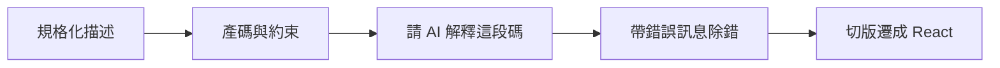
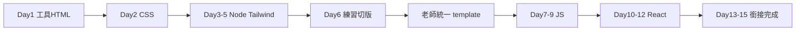
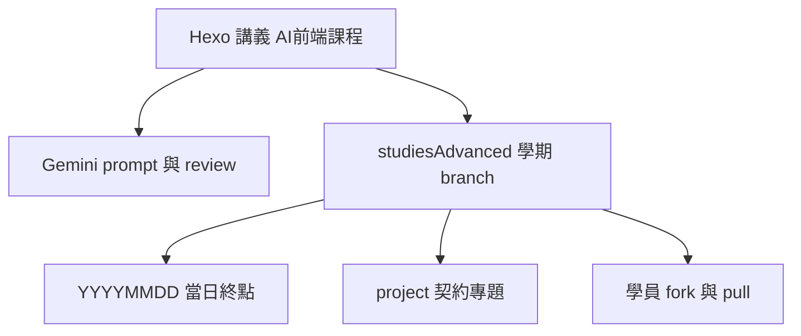

# 15 天 Gemini 前端課程計劃

這是一套**新課程、新分類、新寫法**。舊文只做分類搬家，不當課表骨架，不在每日講義裡逐章對照。

## 分類打散

站內目前約 32 篇第一分類是 `職訓教材`。執行時：

- **全部改為** `基礎網頁教材`（front matter 第一個 `categories`）。第二分類維持技術名：`HTML/CSS`、`JavaScript`、`ReactJS`、`Bootstrap`、`jQuery`、`範例實作網站` 等。
- **廢止** `職訓教材` 這個名稱；分類頁之後不應再出現。
- **新課**第一分類：`AI 前端課程`。統一 tag：`Gemini`、`AI 輔助開發`、`15天前端`、`洛奇旅行`。
- 舊文上的班別 tag（假日班／職前班）可留著當歷史標籤，不必為了新課改內容。
- `Archived Courses` 不動。
- Tailwind 兩篇現在是 `Misc Notes`：可改歸 `基礎網頁教材` + `HTML/CSS`，當獨立參考書；**新課正文自寫 Tailwind 用法**，不要求學員先讀完那兩篇。
- 同步改 [.cursor/rules/hexo-rule.mdc](.cursor/rules/hexo-rule.mdc) 的 Front Matter 範例：拿掉「職訓教材」，改成 `AI 前端課程` / `基礎網頁教材`。

執行時與 Day 1 同一批改名，並改 hexo-rule 範例。

## 教學哲學（已鎖定）

對齊你自己的工作流：**Prompt → AI Agent → Code Review**。這門課要練的就是後兩項能力裡、新手最缺的那兩塊——**會下規格（prompt）**、**會審產出（review）**。Agent 產碼是手段，不是學習目標。

因此：**要解釋技術，否則無法 review。** 但解釋的目的是審稿，不是把學員練成手刻機器。

- 不會語意 HTML，就看不出 AI 用一堆 `div` 冒充結構。
- 不會盒模型／Flex，就看不出 layout 為什麼在手機爛掉。
- 不會事件與狀態，就看不出 `useState` 放錯層、或把 DOM 操作塞進 React。
- 不會 pnpm／Vite 在做什麼，就看不出它亂裝套件、改錯 script。

**Prompt 課在練：** 把需求寫成契約（檔名、id、不准做什麼、技術棧），而不是「做一個很炫的網站」。

**Review 課在練：** 對照契約與當日觀念，問四件事——做對了嗎、有沒有多做、有沒有破壞明天要用的 id、我能不能用白話講這段？講不出來就不准合進專題。

觀念深度用「review 詞彙表」卡關，不追求寫得出來：

| 教到會 review | 不必教到會默寫 |
| --- | --- |
| 標籤／語意／表單對應關係 | 所有 HTML 屬性百科 |
| 選擇器打到誰、層疊誰贏 | BEM 全書、Float 排版史 |
| Flex／Grid 軸向與斷點 | 手刻複雜 Grid 作品集 |
| `package.json`、lockfile、dev script | 自幹 bundler |
| 事件綁在誰、狀態存在哪 | 從零實作框架 |
| props 往下、事件往上 | 全套 Hooks、Redux |

課堂節奏對齊工作流：短觀念（拿到今日 review 清單）→ 標準 prompt → Gemini 產碼 → **code review（對契約 + 抽問）** → 過了才合專題。Review 不過就改 prompt 或改一小段，不准「再產一次碰運氣」。

檔名：`ai-15day-00-index.md`、`ai-15day-01-….md` … `ai-15day-15-….md`（不用 `lokiTech-` 前綴）。標題：`[AI 前端] Day N：…`。文末：上一篇／下一篇／總覽。

## 每日講義結構

每篇控制在課堂可上完的長度。

1. 當日目標（語法驗收點 + Gemini 技能）
2. 專題對應（做出哪一塊）
3. 今日 **review 詞彙**（短觀念；手寫只為證明看得懂）
4. **今日契約**：鎖定的檔名、頁面、`id`／元件名（AI 不准改架構）
5. `今日 Prompt`：標準提示詞（內嵌契約）
6. `Code Review 清單`：結構對齊官方 + 能口述這段 + 有無多餘套件／多餘檔
7. 一則反面提示詞；**今日終點**對照（講義關鍵片段 + studiesAdvanced 當日資料夾）
8. 下一天預告（明天從哪個檔、哪段繼續）

總覽可做一篇索引（不佔上課日）。`<!-- more -->` 前不放 Hexo 標籤。不附「舊教材閱讀地圖」。

## Gemini 工作流（與專題同等級）

**工具（Day 1）：** VSCode、Git（fork `"CLASS_BRANCH"`）、Google 帳號、Gemini 網頁。套件**不靠講義清單當主來源**：repo 根目錄 `.vscode/extensions.json` 寫 `recommendations`，學員拉下來後讓 VS Code 跳出建議安裝（含 Gemini Code Assist）。Node／pnpm 等到 Day 3–5。學員建 `prompts/`。

**守則：** 先規格再產碼；空提示禁止；說不出在做什麼未過關；約束寫進提示（繁中、語意 HTML、**pnpm**、Tailwind v4、React 19、不亂裝套件）；除錯要帶完整錯誤；不貼金鑰與個資。課堂指定 Gemini，不把 Copilot／ChatGPT 當主軸。不強制自架 API Key。

| 階段 | 學員要會 | 天次 |
| --- | --- | --- |
| 規格 | 角色、目標頁、區塊、不要做什麼 | Day 1–2 |
| 產碼 | 在契約內改檔，對得上官方結構 | Day 3–6 |
| 解釋 | 逐段說明看不懂的 class／語法 | 全程 |
| 除錯 | 重現步驟 + Console／終端機 | Day 7–9 |
| 重構 | 切版遷 React | Day 10–15 |

## 同一條專題（前期切版 → 後期完成）

你已定的條件：

- 學員**沒學過**，15 天內要**做完**專題。
- 專題：**洛奇旅行**官網（介紹＋套裝行程＋預約報名）。不是郵輪艙位日曆，不是飯店／露營訂房。
- 4 頁官網：首頁介紹、行程列表、行程詳情、報名／聯絡（Day 6 切這四頁）。
- **後台不進切版：** React 再加 `/admin`，只做 `/tours` 的增刪改。官網前台以 GET 列表／詳情＋ POST 報名為主。
- 報名表在**第四頁**；詳情頁 CTA 帶 `tourId` 過去（query 或 state）。不在詳情頁直接 POST。不做「到報名頁再自己另選一團」當主流程（下拉可有但預設已選）。
- CRUD：`/tours` 給列表與後台增刪改；`/bookings` 給報名。
- 品牌：**洛奇旅行**。路徑與 id 不隨名稱改。
- **切版兩階段（不靠 Figma MCP）：**
  - **練習：** 老師給 **官方 template 的截圖**（同一套四頁，**含桌機與手機**），學員用 Gemini／agent 依圖產版。
  - **第二階段起始：** Day 7 換成老師統一 **Vite + Tailwind 四頁成品，且必須是 RWD**（Tailwind 斷點，手機／平板／桌機能用）。json-server 之後再接。

- Day 3–5：pnpm + Vite + Tailwind。
- Day 6：官方四頁截圖＋agent 切版練習（可發散）。
- Day 7 開頭：全班改用老師 **含 RWD** 的 Vite+TW template，再開始 JS／json-server。
- Day 7–9：JS（含 json-server + fetch CRUD）。
- Day 10–12：React。Day 10 獨立小練習；Day 11–12 開始拆洛奇旅行元件。
- Day 13–15：切版遷 React；前台 fetch；`/admin` 做 tours CRUD；期末教 **GitHub Pages**（靜態站）。json-server 只在本機；上線改讀打包進去的 JSON，或註明 API Demo 僅本機。

## 假 API（已選：只留 json-server）

行程封面圖放 **repo 內資產**（離線教室可用），路徑契約之後寫進 `db.json` 的 `image` 欄。

不教 Firebase、Apps Script、Google Forms API；不用 JSONPlaceholder 當專題後端。

## 15 天課表（你定的進度；每天 8h，共 120h）

沒有 Day 0。編號 Day 1–15。

| Day | 主題 | 當日產出（草案，細節可再改） |
| --- | --- | --- |
| 1 | VSCode、套件、Git、HTML、Gemini 守則 | 能開檔、commit、寫出語意骨架 |
| 2 | CSS | 能 review 選擇器、盒模型、Flex／Grid 夠切版用 |
| 3–5 | Node、pnpm、Vite、Tailwind | 專案能 `pnpm dev`，用 utility 排版 |
| 6 | 主題、切版練習 | 依官方截圖用 agent 產版（可發散） |
| 7–9 | JavaScript | Day 7 先換成老師 template，再接 json-server 與 fetch |
| 10–12 | React | Day 10 小練習；11–12 拆洛奇旅行元件 |
| 13–15 | 銜接切版、完成 React 專題 | 四頁 SPA＋`/admin`；教 GitHub Pages |

課堂不追求講完 Float 深水、全套 Hooks、自架後端。

## 防止專題發散（連續課能上下去）

擔心「教材都是 prompt → 每人 code 長不一樣 → 後面講義對不上」是對的。解法不是禁止用 AI，而是 **AI 只負責填契約，契約由教材鎖死**。

**三層鎖定：**

1. **結構契約（全班相同）**  
   檔名（官網）：`index.html` / `tours.html` / `tour.html` / `booking.html`。React：`/`、`/tours`、`/tours/:id`、`/booking`，另加 `/admin`。  
   id：`#site-header`、`#nav-toggle`、`#tour-list`、`#tour-filters`、`#booking-form`、`#admin-tour-form`。  
   `tours`：`id`, `title`, `place`, `days`, `price`, `image`, `intro`。`bookings`：`tourId`, `name`, `email`, `people`。品牌：**洛奇旅行**。列表篩選 `place`、`days`；無名額欄位。

2. **今日起點／今日終點 → 用 studiesAdvanced 既有節奏**  
   見下一節。講義裡的程式範例只假設**該日資料夾的官方終點**，不假設學員自己的發散版。

3. **提示詞寫法（收斂，不是開放創作）**  
   課堂主提示必須包含：只改哪個檔、保留哪些 id、禁止新增依賴、禁止改檔名。  
   允許發散：配色 token、短文案、圖片 URL。  
   禁止發散：頁數、路由、套件、HTML 骨架、元件拆法。  
   老師示範用**同一則提示詞**；學員先跑標準提示，通過結構驗收後才准「在契約內美化」。

**驗收先過結構再過美感：** 明天要用的 `#nav-toggle` 在不在，比好不好看優先。抽查用瀏覽器檢查元素，不是只看畫面漂不漂亮。

Day 7–9 的 JS 小練習可與專題分開（`exercises/` 或當日資料夾），合進專題時只改契約內的檔。

## 官方隨課 repo（studiesAdvanced）

路徑：[ /Users/loki/github/studiesAdvanced/ ](/Users/loki/github/studiesAdvanced/)，遠端 [summer10920/studiesAdvanced](https://github.com/summer10920/studiesAdvanced)。學員 **fork** 本期 branch，不是把講義 repo（本 Hexo 站）當作業區。

沿用你現在的習慣，不另發明 tag／`day-N-start` 分支：

- **一學期一條 branch：`"CLASS_BRANCH"`**（學員 fork 這條）。開發草稿可暫放 `ai-classes`，開課前再進 `"CLASS_BRANCH"`。
- **新學期**：從乾淨起點開新 branch（readme、契約說明、空的 `project/` 或 Day 1 起始檔），不要直接沿用上期累積的日期資料夾。
- **每日資料夾 `YYYYMMDD/`**：與 `11501/rwd`、`11403/js` 相同。下課後把**當天官方終點**推進該資料夾並 push。學員隔週／隔堂 `git pull`（或下載 ZIP）。
- **進行中的專題**可放 `project/`（舊 RWD／JS 班已這樣用）：契約鎖定的那份累積專案；當日練習、prompt 範本放在當天日期資料夾。
- 學員 AI 玩壞：**換成老師 template 或當日官方終點**，不准帶分叉架構進 JS／React。

Hexo 站寫觀念、prompt、review 清單；studiesAdvanced 放可跑的檔。兩邊檔名／id 必須同一套契約。

## Day 3–5：Node 專案規劃（pnpm）＋ Tailwind

Day 1–2 用靜態頁。Day 3 起才上 Node，因為 Tailwind 要編譯。這是第一次規劃前端專案，React 沿用同一套。

講義必寫、學員必能口述：

- 為什麼需要 Node：跑 Vite、編譯 Tailwind，不是寫後端。
- Node LTS；`node -v`、`pnpm -v`。
- **pnpm**：`init` / `create vite` / `add` / `dev`；`package.json`、lockfile、`.gitignore`。
- Vite + Tailwind v4；提示詞鎖定 pnpm，不要被帶去 npm 或舊版 `tailwind.config.js` 當唯一做法。

Day 10 建 React 時沿用 pnpm + Vite，只換 template。

## 架構關係

## 執行批次

1. 分類搬家 + 更新 hexo-rule（獨立、可先做）
2. Day 1 → 2 → 3–5 → 6 → 7–9 → 10–12 → 13–15

Front matter、note、封面、`<!-- more -->` 仍跟 hexo 撰寫規則；分類名稱改為上面兩套。

## 刻意不做

- 不做成「零觀念 prompt 特訓」，也不做成「傳統語法 15 天、最後一天才碰 AI」。
- 不把每日講義建成「舊 lokiTech 的濃縮版＋post_link 地圖」。
- 不要求學員按舊假日班／Bootstrap 專題路徑走。
- 不在新課內系統講 jQuery、Bootstrap、PHP。
- 不做 Firebase、Apps Script、官方 Google Forms API。
- 不把 ChatGPT／Copilot 當主軸。
- 不規劃學員使用 Figma MCP（免費額度不夠）；切版練習用 demo 圖，專題第二階段用老師 template。
- 不做訂房／入住日曆（舊飯店、露營商務站的核心，這次刻意拿掉）。
- 不把成績建立在「AI 產出好不好看」，而建立在 prompt 契約完整度與 review 過關。
- 分類搬家時不改舊文章教學內容（只改 categories，必要時順便改規則檔）。
